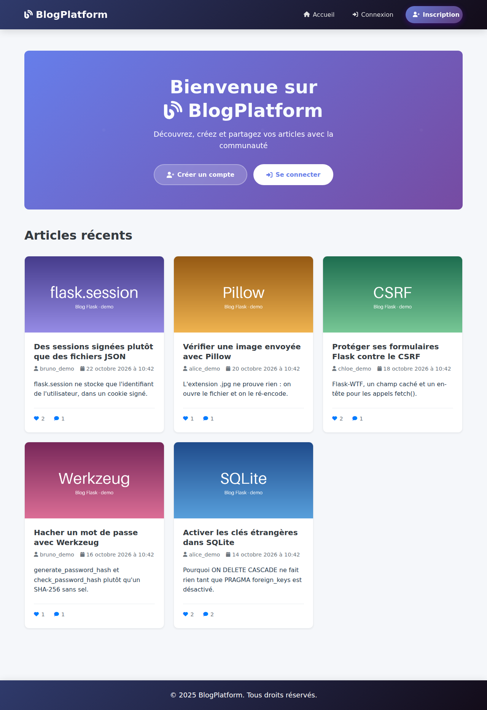
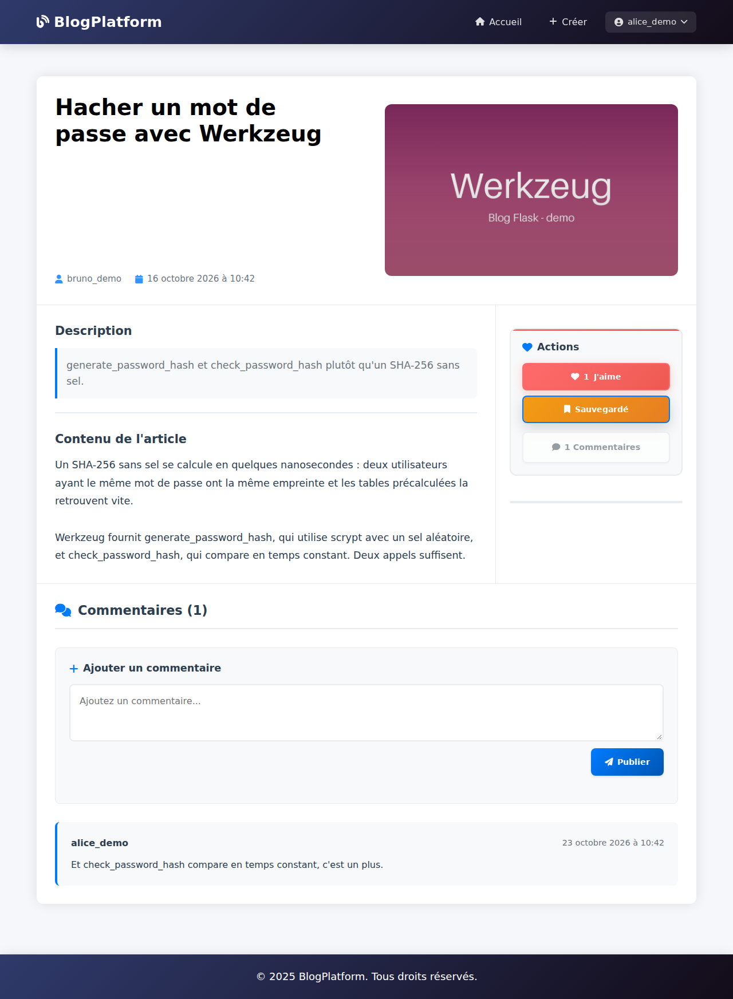
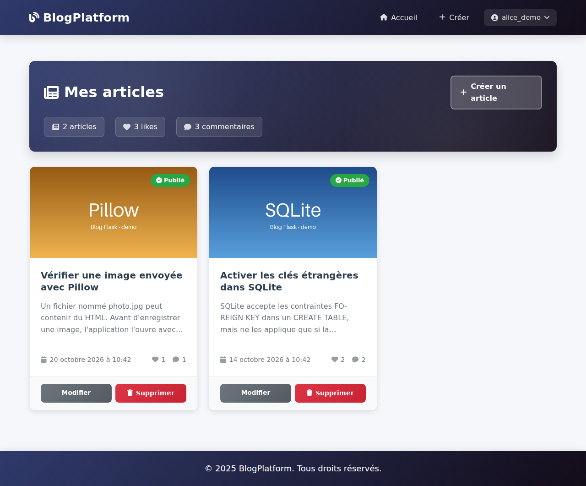
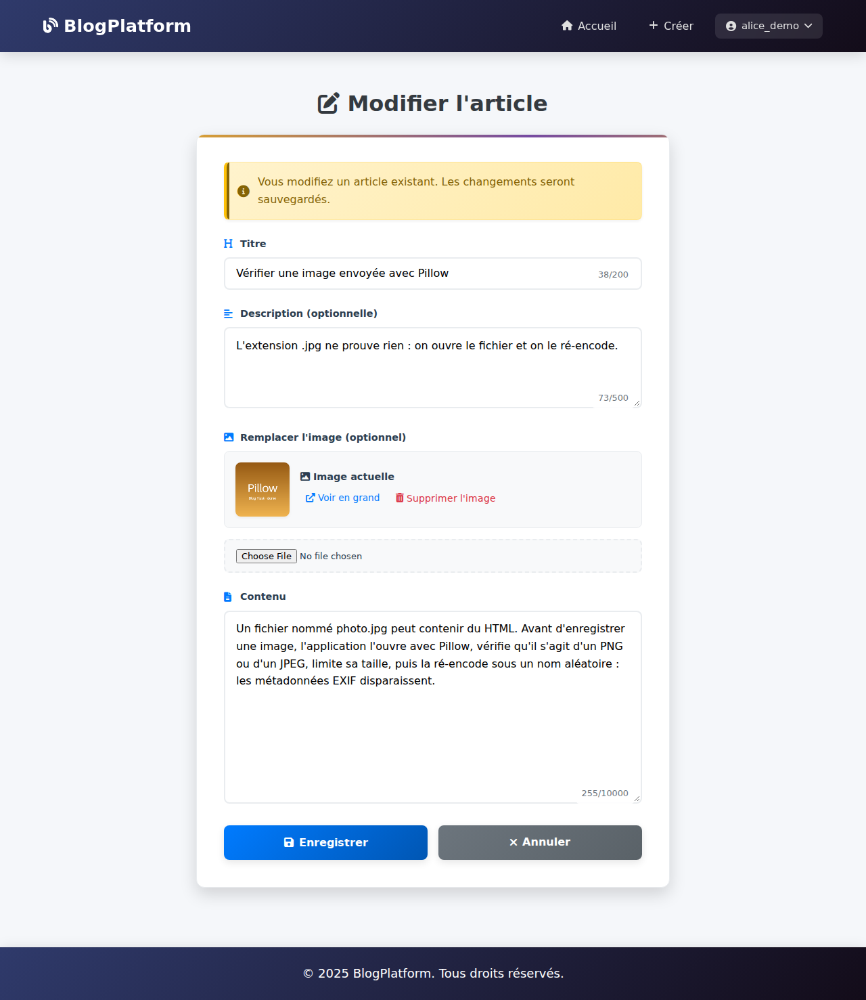

# Blog Flask + SQLite

[](https://github.com/blcoussama/PYTHON-FLASK-SQLITE/actions/workflows/ci.yml)

Plateforme de blog en Python : inscription et connexion, publication d'articles illustrés, commentaires, likes et articles sauvegardés, avec Flask, Jinja2 et SQLite.



## Fonctionnalités

- Inscription, connexion et déconnexion (session de 7 jours).
- Articles : création, modification et suppression par leur auteur, avec titre, description, contenu et image facultative (PNG ou JPEG, 5 Mo maximum). L'image peut être remplacée ou retirée.
- Commentaires, likes et sauvegardes (appels `fetch()` sans rechargement de la page).
- Pages « Mes articles », « Articles aimés » et « Articles sauvegardés ».
- Script de données de démonstration factices.

| Article (connecté) | Mes articles | Modification |
|---|---|---|
|  |  |  |

Captures prises sur l'application lancée en local avec les données de `scripts/seed_demo.py`.

## Stack

- Python 3.11 à 3.13, Flask 3.1, Jinja2, Werkzeug
- SQLite (module `sqlite3` de la bibliothèque standard, requêtes paramétrées)
- Flask-WTF (protection CSRF), Pillow (contrôle des images)
- HTML, CSS et JavaScript sans framework, Font Awesome
- pytest, pip-audit, GitHub Actions

## Architecture

```
main.py                  fabrique create_app(), configuration, routes (Blueprint), erreurs
database.py              accès SQLite : schéma, utilisateurs, articles, commentaires, likes
handlers/
  auth_handler.py        validation de l'inscription et de la connexion
  article_handler.py     validation et règles des articles (propriété, longueurs)
utils/uploads.py         vérification, ré-encodage et suppression des images
templates/               pages Jinja2 (base, auth, articles, user, partials)
static/                  CSS et JavaScript par page
scripts/seed_demo.py     données de démonstration factices
tests/                   suite pytest
data/                    base SQLite et images envoyées (créé au lancement, non versionné)
```

## Installation et lancement local

```bash
git clone https://github.com/blcoussama/PYTHON-FLASK-SQLITE.git
cd PYTHON-FLASK-SQLITE
python -m venv .venv
source .venv/bin/activate          # Windows : .venv\Scripts\activate
pip install -r requirements.txt

# Clé de signature des sessions (obligatoire)
export SECRET_KEY="$(python -c 'import secrets; print(secrets.token_hex(32))')"
export FLASK_DEBUG=1               # développement local uniquement

python scripts/seed_demo.py --reset   # facultatif : comptes et articles de démo
python main.py                        # http://127.0.0.1:8000
```

`flask --app main run` fonctionne aussi (port 5000). Les deux commandes lisent un fichier `.env` à la racine s'il existe (python-dotenv).

Comptes de démonstration : `alice_demo`, `bruno_demo`, `chloe_demo` (adresses `@example.com`), mot de passe `demo1234` ou la valeur de `DEMO_PASSWORD`.

## Variables d'environnement

| Variable | Obligatoire | Rôle |
|---|---|---|
| `SECRET_KEY` | oui | Signe le cookie de session. L'application refuse de démarrer sans elle. |
| `FLASK_DEBUG` | non | `1` active le mode debug (développement local uniquement). Désactivé par défaut. |
| `SESSION_COOKIE_SECURE` | non | Cookie envoyé seulement en HTTPS. Par défaut : activé hors mode debug. `0` pour tester en HTTP sans debug. |
| `DATABASE_PATH` | non | Chemin de la base SQLite (défaut `data/blog.db`). |
| `UPLOAD_FOLDER` | non | Dossier des images envoyées (défaut `data/uploads`). |
| `PORT` | non | Port de `python main.py` (défaut 8000). |
| `DEMO_PASSWORD` | non | Mot de passe des comptes créés par `scripts/seed_demo.py` (défaut `demo1234`). |

En production, utiliser un serveur WSGI (gunicorn, waitress) derrière HTTPS, sans `FLASK_DEBUG`.

## Tests

```bash
pip install -r requirements-dev.txt
python -m pytest          # 55 tests
pip-audit -r requirements.txt
```

Les tests passent par les vrais formulaires (jeton CSRF compris), sur une base et un dossier d'images temporaires : authentification, CRUD et propriété des articles, likes, sauvegardes, commentaires, cascade des suppressions, échappement HTML, refus des requêtes sans jeton CSRF, cookies de session forgés, uploads refusés. La CI GitHub Actions les lance sur Python 3.11, 3.12 et 3.13, puis audite les dépendances.

## Sécurité

- Mots de passe hachés avec `generate_password_hash` (scrypt salé) et vérifiés avec `check_password_hash` ; l'empreinte ne quitte jamais la base.
- Session Flask signée par `SECRET_KEY`, qui ne contient que l'identifiant de l'utilisateur ; nouvelle session à chaque connexion.
- Cookie de session `HttpOnly`, `SameSite=Lax` et `Secure` hors mode debug.
- Jeton CSRF (Flask-WTF) sur toutes les requêtes POST : formulaires et appels `fetch()` (en-tête `X-CSRFToken`). La déconnexion se fait en POST.
- Images : contenu vérifié par Pillow (PNG ou JPEG réel, 25 mégapixels et 5 Mo maximum), ré-encodage sous un nom aléatoire sans métadonnées EXIF, requête limitée à 6 Mo, anciennes images effacées. Elles sont servies par `/uploads/<nom>`, limité aux noms générés.
- Seul l'auteur peut modifier ou supprimer un article (403 sinon).
- Requêtes SQL paramétrées, clés étrangères SQLite activées, échappement automatique de Jinja2.
- En-têtes `X-Content-Type-Options: nosniff`, `X-Frame-Options: DENY`, `Referrer-Policy: same-origin`.
- Mode debug désactivé par défaut ; erreurs inattendues journalisées, messages génériques côté utilisateur.

## Limites connues

- Pas de limitation du nombre de tentatives de connexion ni de réinitialisation du mot de passe.
- La déconnexion efface le cookie, mais un cookie de session copié avant reste valable jusqu'à son expiration (7 jours) : c'est le fonctionnement des sessions signées côté client.
- Pas de Content-Security-Policy : les templates utilisent encore des gestionnaires `onclick` en ligne.
- Pas de page de profil ni de pagination (la page d'accueil affiche les 50 articles les plus récents).
- SQLite convient à une démonstration ou à un petit site, pas à une forte charge en écriture.

## Origine du projet

Projet d'école réalisé pendant ma formation d'ingénieur. La première version reposait sur le module `http.server` de la bibliothèque standard et un moteur de templates maison ; l'application a ensuite été migrée vers Flask et Jinja2 (voir l'historique des commits).

### Ce que j'ai ajouté / corrigé (octobre 2026)

- Historique nettoyé : l'environnement virtuel Windows, les fichiers `.pyc`, la base SQLite, les fichiers de session et les images d'exemple, versionnés par erreur, ont été retirés de tous les commits.
- Sessions : les fichiers JSON nommés d'après le cookie `session_id` (traversée de chemin possible) sont remplacés par `flask.session` signée ; `SECRET_KEY` par variable d'environnement, obligatoire.
- Hachage des mots de passe : SHA-256 sans sel remplacé par Werkzeug (scrypt) ; l'empreinte n'est plus copiée dans la session.
- Protection CSRF sur toutes les routes POST, déconnexion en POST, cookie `SameSite=Lax`, `HttpOnly` et `Secure`.
- `debug=True` en dur remplacé par `FLASK_DEBUG`.
- Uploads vérifiés par Pillow, taille limitée, anciennes images supprimées ; bouton « Supprimer l'image » enfin traité côté serveur.
- `PRAGMA foreign_keys = ON` (les suppressions en cascade ne s'appliquaient pas), exceptions journalisées, code mort retiré (`UserHandler`).
- `base.html` chargeait un `main.js` supprimé : il charge désormais `base.js`. Contenu des articles sans indentation parasite, dates en français.
- Dépendances épinglées, `.gitignore`, script de données de démo, 55 tests pytest, CI GitHub Actions, ce README.
